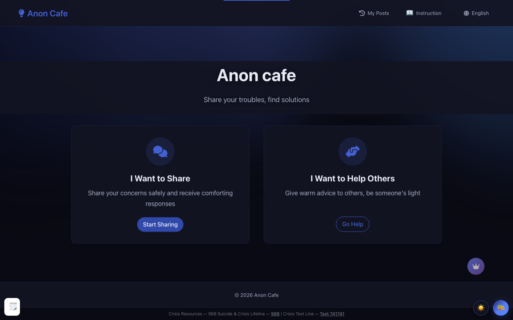

# AnonCafe



An online version of 解忧杂货铺 ("The Miraculous Kiosk of Lost Time") — write
your worry into the box, get an access code, and read the replies when you come
back. No account, no profile; the whole exchange stays anonymous.

**Live:** [anoncafe.life](https://anoncafe.life)

## Features

- **Anonymous sharing** — submit a worry without signing up
- **Access codes** — the only key to your post; come back any time to read replies
- **Email notifications** — a nudge when someone answers (optional, server-side)
- **Five UI languages** — English / 中文 / 日本語 / 한국어 / Español, auto-detected and switchable
- **Responsive** — comfortable on desktop and mobile

## Stack

- React 18 + TypeScript + Vite
- Plain React + the site's own CSS components (no UI framework in the public pages)
- i18next for translations
- Supabase (Postgres + Row Level Security) for data and access-code auth
- A Vercel serverless function for reply notifications (`api/`)
- Vitest for unit tests, Playwright for e2e

## Quickstart

```bash
npm install
cp .env.example .env.local   # fill VITE_SUPABASE_URL + VITE_SUPABASE_ANON_KEY
npm run dev                  # http://localhost:3000
```

Optional, server-side only (reply emails): set `RESEND_API_KEY` and
`RESEND_FROM_ADDRESS`. `SUPABASE_SERVICE_ROLE_KEY` belongs in `api/**` against
a local env — never in a `VITE_` variable, which would ship it to the browser.

## Scripts

| Command | What it does |
|---|---|
| `npm run dev` | Vite dev server on :3000 |
| `npm run build` | Type-check + production build |
| `npm run type-check` | `tsc` for app + api |
| `npm run lint` | ESLint |
| `npm test` | Vitest unit suite |
| `npm run test:e2e` | Playwright e2e (needs `npx playwright install chromium`) |

## Layout

- `src/components` — screens, forms and shared UI
- `src/context` — session context
- `src/lib` — helpers (storage, i18n, Supabase client)
- `api/` — Vercel serverless functions
- `supabase/migrations` — database schema
- `e2e/` — Playwright specs
- `docs/` — setup and ops notes (see `docs/HISTORY.md` for a note about the commit history)

## What it is

The worry box comes from Keigo Higashino's novel *The Miraculous Kiosk of Lost
Time* (东野圭吾《解忧杂货店》): people write their worries and slip them through
the shop's mail slot, and a reply comes back. The app keeps the part that
matters — writing it down helps, and a stranger who cares can write back.
